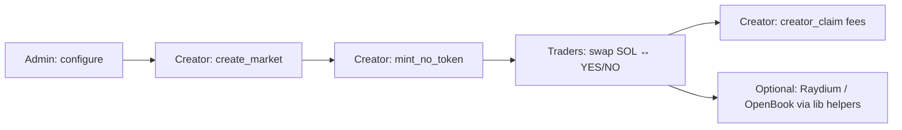

# Solana Prediction Market Smart Contract

Open-source **Solana prediction market** program built with **Anchor**. Launch binary **YES / NO** outcome markets, trade on bonding curves with SOL, collect platform and creator fees, and extend the stack with TypeScript helpers for **Raydium** / OpenBook integration.

> **Use cases:** decentralized forecasting, event betting, opinion markets, and any app that needs on-chain binary outcome tokens on Solana.

---

## Table of Contents

- [Overview](#overview)
- [How It Works](#how-it-works)
- [Features](#features)
- [Tech Stack](#tech-stack)
- [Project Structure](#project-structure)
- [Program Instructions](#program-instructions)
- [Prerequisites](#prerequisites)
- [Installation](#installation)
- [Build & Deploy](#build--deploy)
- [Configuration (Admin)](#configuration-admin)
- [CLI Reference](#cli-reference)
- [Events & Integration](#events--integration)
- [Raydium / OpenBook Helpers](#raydium--openbook-helpers)
- [Program ID](#program-id)
- [Security Notice](#security-notice)
- [Contact](#contact)
- [Keywords](#keywords)

---

## Overview

This repository ships a production-style **prediction market smart contract** for the Solana blockchain. The on-chain program (`takesfun`) lets you:

1. **Create markets** with separate YES and NO SPL tokens (with Metaplex metadata).
2. **Trade** SOL against YES or NO tokens using a **constant-product bonding curve**.
3. **Route fees** to a platform treasury and market creators.
4. **Operate secondary markets** where a backend signer co-signs creation and swaps (for gated or app-controlled launches).

A **TypeScript CLI** and shared `lib/` utilities help you configure, launch, swap, and claim without writing transactions from scratch. The repo also includes **Raydium SDK** dependencies and OpenBook market layout helpers for teams that want to graduate liquidity to a DEX after the curve phase.

If you are searching for a **Solana prediction market template**, **binary outcome market program**, or **Anchor prediction market example**, this repo is intended as a starting point you can audit, deploy, and customize.

---

## How It Works

### Market lifecycle



1. **Configure** — The program authority sets global fees, reserve parameters, team wallets, and launch limits.
2. **Create market** — A creator initializes the `Market` account and the YES mint (and associated metadata).
3. **Mint NO token** — The NO outcome mint and metadata are created in a follow-up instruction.
4. **Swap** — Users buy (`direction = 0`) or sell (`direction = 1`) YES (`token_type = 1`) or NO (`token_type = 0`) tokens against SOL. Slippage is enforced via `minimum_receive_amount`.
5. **Claim** — Creators withdraw accumulated SOL from their creator vault PDA.

### Bonding curve

Each side (YES and NO) maintains **virtual** and **real** SOL and token reserves. Swaps use a **constant product** formula (`x * y = k`) with:

- Platform fees on buy and sell (standard and reduced “small” fee tiers for whitelisted users).
- Creator fees on buy and sell.
- **Cross-side liquidity shift** on buys (configurable `cross_sol_factor`), which links YES and NO reserve dynamics.

On-chain state is defined in `Market`:

| Field | Purpose |
|--------|---------|
| `yes_token_mint` / `no_token_mint` | Outcome token mints |
| `creator` | Market owner |
| `real_*` / `virtual_*` reserves | Bonding curve liquidity |
| `is_completed` | Market completion flag |
| `market_info` | App-defined market identifier (string) |

---

## Features

| Feature | Description |
|---------|-------------|
| **Binary prediction markets** | YES and NO SPL tokens per market |
| **Bonding curve trading** | Buy and sell with SOL; slippage protection |
| **Metaplex metadata** | Token name, symbol, and URI for each outcome |
| **Global config** | Admin-controlled fees, supplies, and reserve defaults |
| **Creator fee vaults** | Per-market PDA vaults for creator earnings |
| **Whitelist** | Reduced platform fees for approved creators |
| **Secondary market flow** | `create_market_second`, `swap_second`, `creator_claim_second`, `change_creator` with backend co-signing |
| **On-chain events** | `LaunchEvent` and `TradeEvent` for indexers and frontends |
| **TypeScript CLI** | Scripts for config, launch, swap, claim, and whitelist |
| **DEX-ready helpers** | `lib/create-market.ts` uses Raydium / Serum layouts for OpenBook market accounts |

---

## Tech Stack

| Layer | Technology |
|-------|------------|
| On-chain program | Rust, [Anchor](https://www.anchor-lang.com/) **0.30.1** |
| Program name | `takesfun` |
| Client / CLI | TypeScript, `@coral-xyz/anchor`, Commander |
| Tokens | SPL Token, Metaplex Token Metadata |
| DEX integration (off-chain helpers) | `@raydium-io/raydium-sdk`, `@project-serum/serum` |

---

## Project Structure

```
Solana-Prediction-Market-Smart-Contract/
├── programs/takesfun/          # Anchor program (Rust)
│   └── src/
│       ├── lib.rs              # Instruction entrypoints
│       ├── state/              # Config, Market, Whitelist accounts
│       ├── instructions/       # Admin + market handlers
│       ├── events.rs           # LaunchEvent, TradeEvent
│       └── errors.rs           # Program error codes
├── cli/                        # Commander CLI (command.ts, scripts.ts)
├── lib/                        # Shared TS utilities (create-market, constants)
├── Anchor.toml                 # Anchor toolchain & cluster config
├── package.json                # Yarn scripts and dependencies
└── keys/                       # Example keypairs (not for production secrets)
```

---

## Program Instructions

### Admin

| Instruction | Description |
|-------------|-------------|
| `configure` | Set global `Config` (fees, reserves, wallets, authority) |
| `nominate_authority` | Propose a new admin pubkey |
| `accept_authority` | Pending admin accepts ownership |
| `add_wl` | Add a creator to the whitelist |

### Primary market flow

| Instruction | Description |
|-------------|-------------|
| `create_market` | Create YES mint, market account, and YES metadata |
| `mint_no_token` | Create NO mint and metadata |
| `swap` | Buy or sell YES/NO tokens for SOL |
| `creator_claim` | Creator withdraws SOL from creator vault |

### Secondary market flow (backend co-sign)

| Instruction | Description |
|-------------|-------------|
| `create_market_second` | Create market with `creator_wallet` and backend signer |
| `swap_second` | Swap keyed by `market_info` string |
| `creator_claim_second` | Claim fees for a secondary market |
| `change_creator` | Transfer market creator (admin/backend flow) |

### Swap parameters

- `amount` — Input amount (lamports for buy, token amount for sell depending on direction).
- `direction` — `0` = buy, `1` = sell.
- `token_type` — `0` = NO, `1` = YES.
- `minimum_receive_amount` — Minimum output; reverts with `SlippageExceeded` if not met.

---

## Prerequisites

Install the Solana toolchain and Anchor. Official guide: [Solana installation docs](https://solana.com/docs/intro/installation).

| Tool | Version |
|------|---------|
| Rust | stable (via `rustup`) |
| Solana CLI | compatible with Anchor 0.30.1 |
| Anchor | **0.30.1** (via AVM) |
| Node.js | 18+ recommended |
| Yarn | 1.x or Berry |

```bash
avm install 0.30.1
avm use 0.30.1
anchor --version
```

---

## Installation

```bash
git clone https://github.com/<your-org>/Solana-Prediction-Market-Smart-Contract.git
cd Solana-Prediction-Market-Smart-Contract
yarn install
```

Copy environment defaults if you use Anchor’s TS provider locally:

```bash
cp .env.example .env
```

---

## Build & Deploy

### Build the program

```bash
anchor build
```

If you use a custom `CARGO_TARGET_DIR`, symlink the artifact into Anchor’s deploy folder:

```bash
ln -s $HOME/.cargo/target/sbf-solana-solana/release/takesfun.so $PWD/target/deploy/takesfun.so
```

Or use the project script (cleans `target`, builds, copies keypair):

```bash
anchor run build
```

### Local validator (optional)

For local integration testing with token metadata:

```bash
solana config set -ul
solana config set -k ./keys/<your-wallet>.json

solana-test-validator -r --bpf-program metaqbxxUerdq28cj1RbAWkYQm3ybzjb6a8bt518x1s spl-programs/metadata.so
```

Deploy to localnet:

```bash
anchor deploy --provider.cluster Localnet
```

### Devnet

Set `cluster` and `wallet` in `Anchor.toml`, fund your wallet, then:

```bash
anchor deploy
```

---

## Configuration (Admin)

Only the configured **authority** can call `configure` with a `Config` account that includes:

- `authority` / `pending_authority` — two-step admin transfer
- `team_wallet`, `team_wallet2` — platform fee destinations
- `platform_*_fee`, `creator_*_fee` — basis-point style fee settings
- `initial_virtual_*` / `initial_real_*` — default reserve parameters for new markets
- `cross_sol_factor`, `min_sol_liquidity` — cross-side liquidity behavior
- `token_supply_config`, `token_decimals_config` — SPL mint parameters

Use the CLI to initialize config on your cluster:

```bash
yarn script config
```

---

## CLI Reference

All commands accept optional cluster flags:

```bash
yarn script <command> -e devnet -k ./keys/admin.json -r <RPC_URL>
```

| Command | Purpose |
|---------|---------|
| `config` | Initialize / update global program config |
| `market` | Create a primary prediction market (YES, then NO via program flow) |
| `swap` | Trade on a market |
| `claim` | Creator claims SOL from vault |
| `whitelist` | Admin adds whitelisted creator (requires backend tx payload) |
| `market2` | Create secondary market (backend-signed) |
| `swap2` | Swap on secondary market (requires `-m` market info) |
| `claim2` | Creator claim on secondary market |
| `changeCreator` | Change market creator (backend-signed) |

### Examples

**Configure program (devnet):**

```bash
yarn script config
```

**Launch a market:**

```bash
yarn script market
```

**Buy YES tokens** (2,000,000 units — adjust for your decimals):

```bash
yarn script swap \
  -y <YES_MINT> \
  -n <NO_MINT> \
  -a 2000000 \
  -s 0 \
  -t 1
```

| Flag | Meaning |
|------|---------|
| `-y` | YES token mint |
| `-n` | NO token mint |
| `-a` | Swap amount |
| `-s` | `0` = buy, `1` = sell |
| `-t` | `0` = NO token, `1` = YES token |

**Creator claim:**

```bash
yarn script claim -y <YES_MINT> -n <NO_MINT>
```

**Secondary market swap:**

```bash
yarn script swap2 \
  -y <YES_MINT> \
  -n <NO_MINT> \
  -m "<MARKET_INFO>" \
  -a 2000000 \
  -s 0 \
  -t 1
```

---

## Events & Integration

Subscribe to program logs or parse CPI events for:

- **`LaunchEvent`** — market creation, mints, initial reserves, `market_info`
- **`TradeEvent`** — per-swap details, fees, reserve snapshots, direction, `token_type`

Frontends and indexers can use these events to drive charts, order books, and user portfolios without re-simulating the bonding curve off-chain.

**IDL:** After `anchor build`, use `target/idl/takesfun.json` with `@coral-xyz/anchor` or your preferred Solana client.

---

## Raydium / OpenBook Helpers

The on-chain program focuses on **prediction market creation and bonding-curve swaps**. Graduating to a full AMM is supported at the **client layer**:

- `lib/create-market.ts` — builds OpenBook market account layouts (Serum `Market` struct) using Raydium program IDs from `lib/constant.ts`.
- `package.json` includes `@raydium-io/raydium-sdk` for DEX-related workflows.

There is **no** `yarn script migrate` command in this repo; wire your own migration flow using the helpers above once `is_completed` / curve conditions are met in your product logic.

---

## Program ID

| Cluster | Program ID |
|---------|------------|
| Devnet (configured in `Anchor.toml`) | `4D1RaYpBgEAj437RBaCkbKkpN2S2BA4CcmkE35MR1CZv` |

Update `declare_id!` in `programs/takesfun/src/lib.rs` and `Anchor.toml` when you deploy your own program binary.

---

## Security Notice

This code is provided as a **reference implementation** and development starter. Before mainnet use:

- Obtain an independent **security audit**.
- Review admin keys, fee wallets, and backend signer permissions.
- Never commit private keys; replace example paths under `keys/`.
- Validate slippage, completion, and migration logic for your product requirements.

---

## Contact

fiv3fingers.dev@gmail.com

---

## Keywords

Solana prediction market, prediction market smart contract, binary outcome market, YES NO tokens, bonding curve, Anchor program, decentralized forecasting, event market, SPL token metadata, Raydium OpenBook, Solana DeFi, on-chain betting.
